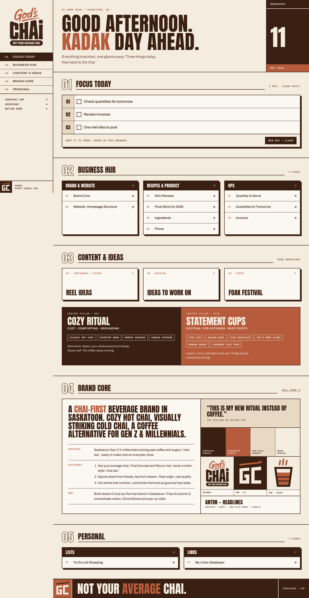

# GC Notion Dashboard

The God's Chai home base: a branded dashboard for the Notion **🏠 Home Dashboard**, plus a Notion kit (cover, icons, sub-logo).

## What's here

| Path | What it is |
| --- | --- |
| `index.html` | The dashboard. One file, no build step. Embeds in Notion (works from ~700px wide up to full desktop). |
| `assets/logo/gods-chai-logo.png` | Primary logo, cropped, transparent background (for light backgrounds). |
| `assets/logo/gods-chai-logo-reverse.png` | Primary logo with cream "CHAI", for chocolate backgrounds. |
| `assets/logo/gc-monogram*.svg` | **Sub-logo, GC monogram**: chocolate, cream, and terracotta tiles. |
| `assets/logo/gc-glass*.svg` | **Sub-logo, cutting-chai glass**: small sizes, favicons, sub-page icons. |
| `assets/notion/notion-cover-1500x600.png` | Notion page cover. |
| `assets/notion/icon-*.png` | 512px Notion page icons. |
| `tools/` | Source for the cover and a script that re-renders the Notion kit (`node tools/render-notion-kit.js`). |

## Design direction

The look is **Swiss grid + neo-brutalism** instead of rounded, soft UI:

- **Square corners only.** No border-radius anywhere.
- **Hard 2px chocolate rules** and **hard offset shadows** (6px, no blur). Cards "press in" on hover.
- **Numbered sections (01–05)** and an index-style nav, as on a printed menu or a Swiss poster.
- **Condensed caps for headlines** (Anton) to echo the chunky "CHAI" letterforms. Archivo for body text, IBM Plex Mono for labels.

### Brand colours (sampled from the logo)

| Token | Hex | Use |
| --- | --- | --- |
| Chocolate | `#3A2012` | Text, rules, headers, the "hot" pillar |
| Terracotta | `#B65C3C` | Accent, highlights, the "cold" pillar (large text and fills only) |
| Terracotta ink | `#9A4A2E` | Terracotta for small text (passes AA contrast on cream) |
| Chai milk | `#E8D9C5` | Quiet fills |
| Cream | `#F5ECE0` | Page background |

### How the Brand Core shapes the design

From *Gods Chai – Brand Core* in Notion:

- **Hot chai = cozy, comforting, grounding**: solid chocolate blocks.
- **Cold chai = exciting, eye-catching**: terracotta blocks, chips, and highlights.
- **"Not your average chai"**: a deliberately unusual, poster-like layout instead of a generic template.
- **"This is my new ritual instead of coffee"**: the daily *Focus Today* block (3 items max, cleared daily) sits at the top.

### Logo rules

- The **primary logo** stays visible at all times: in the left rail on desktop, and in the sticky header at Notion-embed and phone widths.
- Use the **GC monogram** where the primary logo is too tall: favicons, the Notion page icon, footers, and stamps.
- Use the **glass mark** for product, recipe, and ops pages, and at 32px and below.
- Don't round the tiles or put the monogram inside a circle. The square is part of the system.

## Using it in Notion

1. **Host the dashboard.** In this repo on GitHub, go to *Settings → Pages* and deploy from the `main` branch, root folder. You'll get a URL like `https://<user>.github.io/gc-notion-dashboard/`. Any static host works.
2. **Embed it.** On the 🏠 Home Dashboard page, type `/embed`, paste the URL, and stretch the block to full width. Turning on *Full width* for the page gives the desktop layout.
3. **Cover and icon.** Set the cover to `assets/notion/notion-cover-1500x600.png` and the icon to `assets/notion/icon-gc-monogram.png`.
4. **Sub-pages (optional).** Give Recipes, Product, and Ops pages `icon-gc-glass.png`, and Brand and Content pages `icon-gc-monogram-terracotta.png`.
5. **Native Notion blocks.** Notion can't use custom hex colours. The closest built-ins are **Brown** (chocolate) and **Orange** (terracotta). Use them for callouts and headings, and use dividers liberally.

### Editing links

All Notion page links live in one `NOTION` object near the bottom of `index.html`. Change the page ID there if a page moves.

*Focus Today* saves to the browser's local storage, so each browser keeps its own list. The **New day** button clears it.
